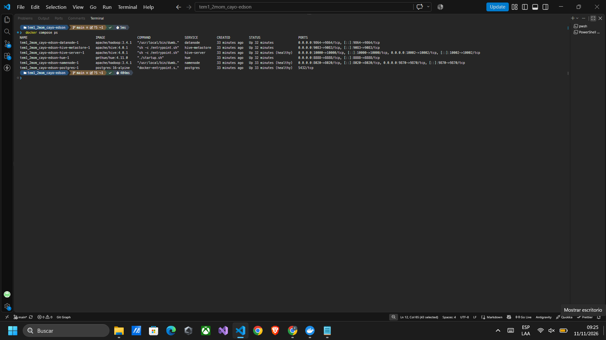

# Análisis de Superstore con Apache Hive

**Estudiante:** Edson Marcelo Cayo Ali · Universidad del Valle · Examen práctico individual, segundo momento.

En esta práctica cargué y revisé el archivo `Sample - Superstore.csv` con Apache Hive. A partir de esos datos analicé las ventas, ganancias, clientes, productos y descuentos.

## Objetivos

- Organizar los datos y comprobar que no tengan errores.
- Comparar las ventas y ganancias por región, cliente, producto y mes.
- Revisar cómo se relacionan los descuentos con las pérdidas y qué productos aportan más al negocio.
- Guardar las consultas, sus resultados y las capturas de ejecución.

## Contenido

| Entregable | Ubicación |
|---|---|
| Diccionario de los 21 campos | [docs/diccionario_datos.md](docs/diccionario_datos.md) |
| DDL y carga DML, pregunta 1 | [scripts/01_ddl.hql](scripts/01_ddl.hql), [scripts/01_dml.hql](scripts/01_dml.hql) |
| Consultas 2 a 8 | [scripts/](scripts/) |
| Desarrollo, resultados e interpretación de cada pregunta | [docs/preguntas_01_08.md](docs/preguntas_01_08.md) |
| Resultados de las consultas | [resultados/](resultados/) |
| Capturas y registros de ejecución | [evidencias/README.md](evidencias/README.md) |
| Optimización | [docs/optimizacion.md](docs/optimizacion.md) |
| Conclusiones | [docs/conclusiones.md](docs/conclusiones.md) |

## Requisitos

- Windows con PowerShell y Docker Desktop en modo contenedores Linux; reservar al menos 8 GB de RAM y espacio para imágenes y volúmenes.
- Puertos disponibles: Hue `8888`, HDFS `9870`, HiveServer2 `10000` y metastore `9083`.
- Archivo original `Sample - Superstore.csv` en la raíz del repositorio.
- Controlador PostgreSQL en `jars/postgres-jdbc.jar`.

El entorno está basado en [tech4242/docker-hadoop-hive-parquet](https://github.com/tech4242/docker-hadoop-hive-parquet/blob/master/README.md): Hadoop 3.4.1, Hive 4.0.1, PostgreSQL 16 y Hue 4.11.0.



## Procedimiento de ejecución

Desde la raíz del proyecto, en PowerShell:

```powershell
docker compose up -d --wait
docker compose ps
powershell.exe -NoProfile -ExecutionPolicy Bypass -File scripts/ejecutar.ps1
```

El script comprueba las 9.994 filas y 21 columnas, crea una copia UTF-8 sin la fila de títulos en `data/data_edson_cayo.csv` y la carga en HDFS. El archivo original se conserva. Después crea la base `superstore_edson` y ejecuta las consultas en orden.

Los datos se leen en `ventas_raw`, se convierten a los tipos necesarios en `ventas_tipadas` y se guardan en `ventas` con formato Parquet. Al repetir la carga, `INSERT OVERWRITE` reemplaza el contenido de esta última tabla. La carpeta `data/` se genera con el script y no se incluye en Git.

Las tablas de resultados se guardan en `resultados/*.tsv`, los mensajes de ejecución en `evidencias/logs/` y los tiempos en `resultados/tiempos.csv`. Un archivo TSV puede contener varias tablas, cada una con sus títulos de columna. Si ocurre un error, el script se detiene e indica dónde revisarlo.

Para repetir únicamente las consultas después de una carga correcta:

```powershell
powershell.exe -NoProfile -ExecutionPolicy Bypass -File scripts/ejecutar.ps1 -SoloConsultas
```

Las consultas también se pueden ejecutar en [Hue](http://localhost:8888), en **Editor → Hive**, seleccionando `superstore_edson`. Se conservan las instrucciones `SET` de cada archivo para trabajar en modo local. La pregunta 1 se ejecuta primero porque prepara los datos usados por las demás.

## Criterios del análisis

Cada fila corresponde a un producto dentro de un pedido. `Sales` y `Profit` ya contienen su venta y ganancia, por lo que no se multiplican por `Quantity`. El margen se calcula como `SUM(profit)/SUM(sales)*100`. Las pérdidas se conservan porque también forman parte del análisis. En RFM se cuentan pedidos distintos y, si dos productos empatan en una lista, se usa su ID para ordenarlos. Cuando no existe un período anterior para comparar, se muestra NULL.

## Fuentes

- [Dataset Superstore en Kaggle](https://www.kaggle.com/datasets/vivek468/superstore-dataset-final).
- [Apache Hive: CSV SerDe](https://hive.apache.org/docs/latest/user/csv-serde/), para respetar comas entre comillas y convertir columnas STRING.
- [Apache Hive: funciones de ventana](https://hive.apache.org/docs/latest/language/languagemanual-windowingandanalytics/), para LAG, rankings y acumulados.

## Apoyo utilizado

Utilicé asistencia de IA para desarrollar y revisar las consultas y la documentación.
