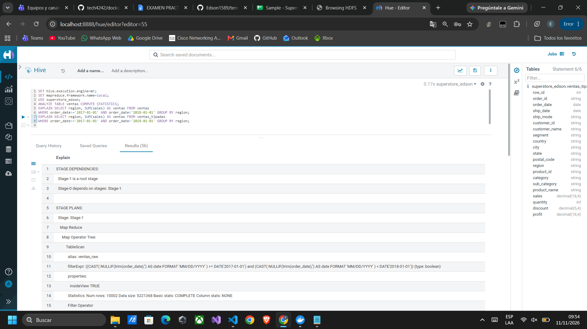

# Análisis de optimización

Para revisar cómo se consultan los datos, comparé el plan de una misma consulta: las ventas por región de 2017, leyendo desde Parquet y desde el CSV. El [script](../scripts/optimizacion.hql), los [planes completos](../resultados/optimizacion.tsv) y el [registro de ejecución](../evidencias/logs/optimizacion.log) están incluidos en el proyecto.

| Decisión | Motivo |
|---|---|
| Usar CSV para la carga y Parquet para las consultas | Los datos quedan preparados y no hay que convertir fechas y números en cada análisis. |
| Guardar los importes como DECIMAL | Permite conservar los cuatro decimales del archivo. El redondeo se realiza al mostrar los resultados. |
| Comprimir Parquet con Snappy | Reduce el espacio que ocupan los datos. |
| Actualizar las estadísticas de la tabla | Ayuda a Hive a decidir cómo ejecutar las consultas. Se utilizó `ANALYZE TABLE ventas COMPUTE STATISTICS`. |
| Filtrar con una fecha inicial y otra final | Permite buscar directamente los pedidos de 2017. |
| Sumar por producto, cliente o mes antes de ordenar | Reduce la cantidad de filas que se ordenan en los cálculos. |
| Reutilizar vistas | Mantiene las mismas reglas de cálculo en las distintas preguntas. Las vistas guardan la consulta, no una copia de sus resultados. |

La captura muestra el plan de lectura del CSV, donde Hive convierte las fechas antes de aplicar el filtro. Los dos planes se encuentran completos en el archivo de resultados.

## Espacio utilizado

| Formato | Tamaño |
|---|---:|
| CSV UTF-8 sin títulos de columna | 2.288.319 bytes |
| Parquet | 428.503 bytes |

Parquet ocupa **81,27% menos espacio**. Los tamaños se obtuvieron con `hdfs dfs -du -s` y están guardados en [almacenamiento.txt](../evidencias/logs/almacenamiento.txt). Esta reducción de tamaño no significa que las consultas sean un 81,27% más rápidas.

## Comprobaciones y alcance

La práctica se ejecutó en modo local. Para la carga y la revisión de calidad se ajustó la lectura de fechas y se retiró la fila de títulos de la copia del CSV, conservando el original.

Los [controles finales](../scripts/validacion.hql) comprobaron los clientes, productos, 48 meses y el límite del 80% en Pareto. Todos terminaron correctamente. En [su resultado](../resultados/validacion.tsv), NULL indica que `ASSERT_TRUE` se cumplió; si hubiera fallado, la consulta mostraría un error.

El [archivo de tiempos](../resultados/tiempos.csv) contiene la última ejecución de la consulta mensual y de los controles. Incluye conexión y guardado de resultados, por lo que no sirve para comparar directamente la velocidad de CSV y Parquet.

Con 9.994 registros no fue necesario dividir la tabla en más archivos. Si el volumen aumentara, se podría evaluar separarla por año y medir varias veces la misma consulta. Las pruebas realizadas comprueban el funcionamiento en este equipo, sin medir el comportamiento de un conjunto de servidores.
