# Desarrollo de las preguntas 1 a 8

**Estudiante:** Edson Marcelo Cayo Ali. **Datos utilizados:** Sample Superstore. En este documento presento las consultas, las capturas de ejecución y los resultados de las preguntas 1 a 8. Las tablas completas se encuentran en `resultados/`.

## 1. Diseño e implementación del modelo de datos

**Enunciado:** construir el almacenamiento en Hive, identificar los campos, elaborar el diccionario y documentar la carga.

**Estrategia:** primero leí las 21 columnas del CSV como texto y después convertí las fechas y los números para guardarlos en Parquet. Conservé el archivo original y preparé una copia UTF-8 sin la fila de títulos. Usé OpenCSVSerde para leer correctamente los nombres que contienen comas.

**Consulta HiveQL:** [DDL completo](../scripts/01_ddl.hql) y [DML y controles de carga](../scripts/01_dml.hql). [Diccionario de datos](diccionario_datos.md). Los pasos para ejecutar la carga están en el README.

**Evidencia:** [registro de creación](../evidencias/logs/01_ddl.log), [registro de carga](../evidencias/logs/01_dml.log) y [resultados completos](../resultados/01_dml.tsv). Las imágenes muestran los campos de la tabla y el conteo de filas cargadas.

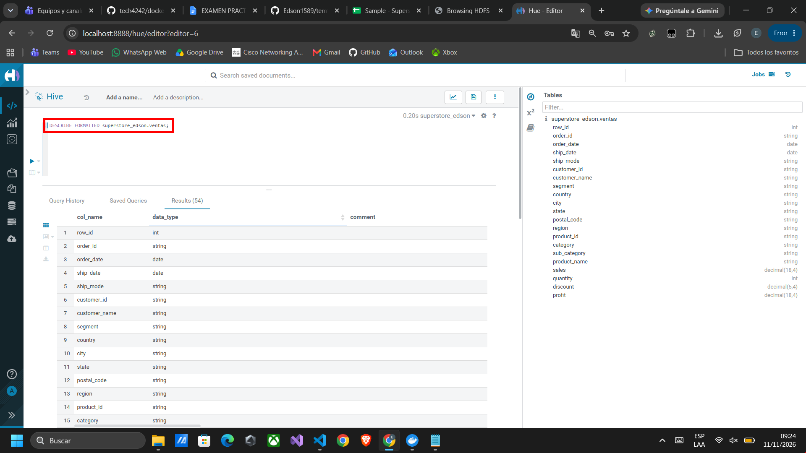

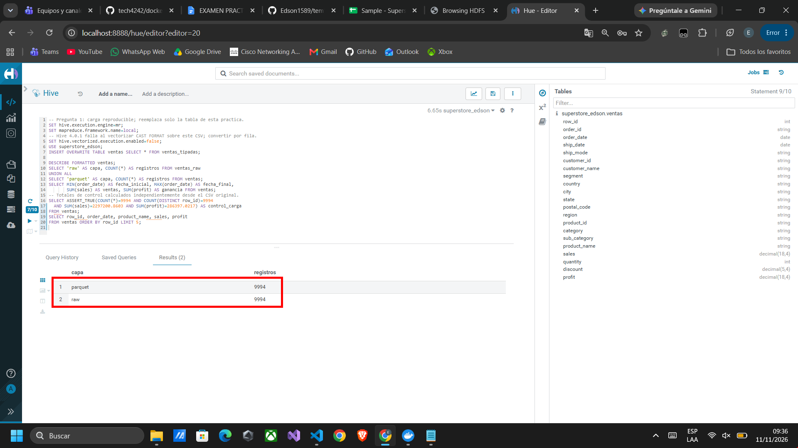

**Resultado obtenido:** 9.994 filas tanto en `ventas_raw` como en `ventas`, con fechas del 3 de enero de 2014 al 30 de diciembre de 2017. Ventas: **2.297.200,8603**; ganancias: **286.397,0217**. Comprobé que no se repitiera ningún Row ID y que la cantidad de filas y los totales coincidieran con el archivo original.

**Interpretación técnica:** guardé las fechas como DATE y los importes como DECIMAL para poder calcular y comparar los resultados. Dejé una tabla para leer el CSV y otra con los datos preparados para el análisis.

**Conclusión:** el modelo conserva los registros y sus importes, con tipos adecuados para las preguntas siguientes.

## 2. Auditoría de calidad e integridad de datos

**Enunciado:** auditar registros, duplicados, órdenes, clientes, NULL, fechas, ventas no positivas, descuentos inválidos y envíos anteriores al pedido; proponer tratamientos.

**Estrategia:** conté las filas, pedidos y clientes, busqué Row ID repetidos y revisé los campos vacíos. También comprobé las fechas, las ventas, las cantidades y los descuentos.

**Consulta HiveQL:** [02_calidad.hql](../scripts/02_calidad.hql).

**Evidencia:** [registro de ejecución](../evidencias/logs/02_calidad.log) y [resultados completos](../resultados/02_calidad.tsv).

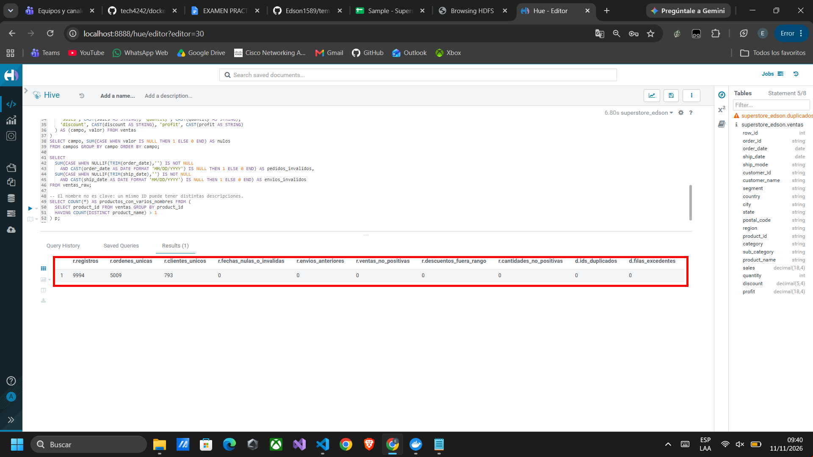

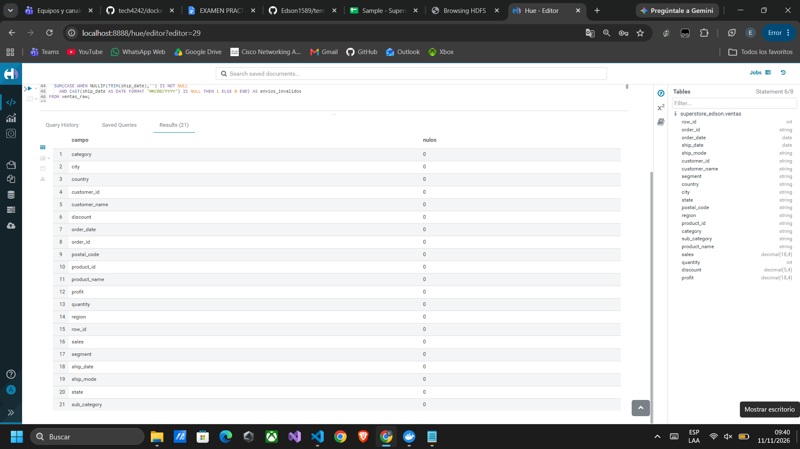

**Resultado obtenido:**

| Control | Resultado |
|---|---:|
| Registros | 9.994 |
| Órdenes únicas | 5.009 |
| Clientes únicos | 793 |
| IDs de fila duplicados / filas excedentes | 0 / 0 |
| NULL en cada uno de los 21 campos | 0 |
| Fechas de pedido/envío inválidas | 0 / 0 |
| Envíos anteriores al pedido | 0 |
| Ventas o cantidades no positivas | 0 |
| Descuentos fuera de [0,1] | 0 |
| IDs de producto con más de un nombre | 32 |

**Interpretación técnica:** no encontré errores en las comprobaciones principales. Sí encontré 32 productos con distintos nombres para un mismo ID. Por eso reuní sus ventas por ID y usé MIN para elegir un solo nombre al mostrarlos.

**Tratamiento de errores:** si aparecieran errores, los revisaría antes de corregirlos o borrar datos, sin inventar fechas ni ventas. Los valores negativos de Profit se conservan porque representan pérdidas registradas en el archivo.

**Conclusión:** utilicé todas las filas porque los controles principales no detectaron errores. Para los productos con varios nombres, mantuve sus ventas agrupadas por ID.

## 3. Análisis de evolución comercial por región

**Enunciado:** calcular ventas, ganancias, margen y variación anual por región e identificar el mejor y peor desempeño.

**Estrategia:** sumé las ventas y ganancias de cada región por año. Después usé LAG para compararlas con el año anterior y calculé el margen. Ordené las regiones según su ganancia total. Para calcular el cambio de ganancia, dividí entre el valor absoluto del año anterior.

**Consulta HiveQL:** [03_regiones.hql](../scripts/03_regiones.hql).

**Evidencia:** [registro de ejecución](../evidencias/logs/03_regiones.log) y [resultados por año y región](../resultados/03_regiones.tsv). Las capturas muestran los totales de todo el período y la comparación por año.

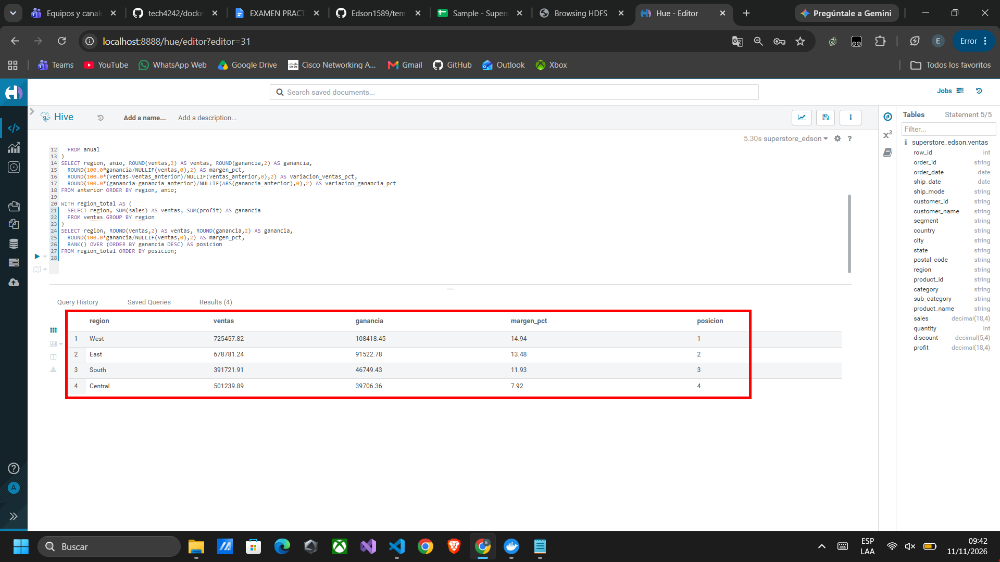

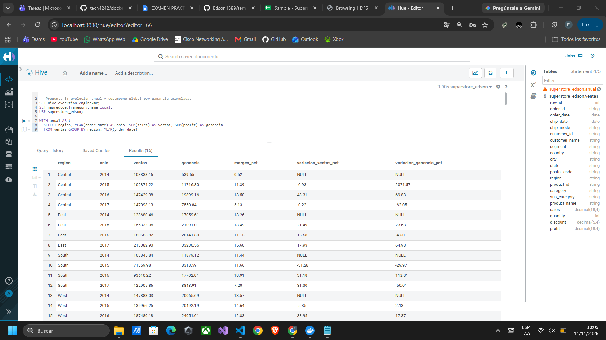

**Resultado obtenido, acumulado 2014–2017:**

| Región | Ventas | Ganancia | Margen |
|---|---:|---:|---:|
| West | 725.457,82 | 108.418,45 | 14,94% |
| East | 678.781,24 | 91.522,78 | 13,48% |
| South | 391.721,91 | 46.749,43 | 11,93% |
| Central | 501.239,89 | 39.706,36 | 7,92% |

En 2017, West aumentó ventas **33,42%** y ganancias **82,15%**. Central redujo ventas **0,22%** y ganancias **62,05%**, respecto a 2016.

**Interpretación técnica:** identifiqué a West como la región de mejor desempeño por ganancia acumulada. Central vende más que South, pero obtiene menos ganancia y el margen más bajo. Esto muestra que no basta con revisar cuánto se vende.

**Conclusión:** conviene revisar la rentabilidad de Central y las condiciones que permiten a West crecer con mayor margen.

## 4. Segmentación avanzada de clientes mediante RFM

**Enunciado:** calcular Recency, Frequency y Monetary, asignar puntuaciones e identificar clientes de alto valor, recurrentes y en riesgo.

**Estrategia:** tomé como referencia el **30/12/2017**. Calculé los días desde la última compra (Recency), la cantidad de pedidos distintos (Frequency) y el total comprado (Monetary). Con NTILE(5) dividí a los clientes en cinco grupos y asigné notas de 1 a 5. Comprar hace poco, comprar más veces y gastar más da una mejor nota. Cuando dos clientes empatan, se ordenan por su ID; por eso pueden quedar en grupos distintos.

Apliqué estas reglas en orden: **Alto valor** si R, F y M son al menos 4; **En riesgo** si R es 1 o 2; **Recurrentes** si F es al menos 4; y **Otros** para los demás. Cada cliente queda en un solo grupo. Estar en riesgo significa que lleva más tiempo sin comprar en comparación con los demás, sin asegurar que haya dejado de ser cliente.

**Consulta HiveQL:** [04_rfm.hql](../scripts/04_rfm.hql), con resumen y detalle de los 793 clientes.

**Evidencia:** [registro de ejecución](../evidencias/logs/04_rfm.log) y [resumen y lista completa de clientes](../resultados/04_rfm.tsv). La captura muestra ejemplos de los valores y grupos asignados.

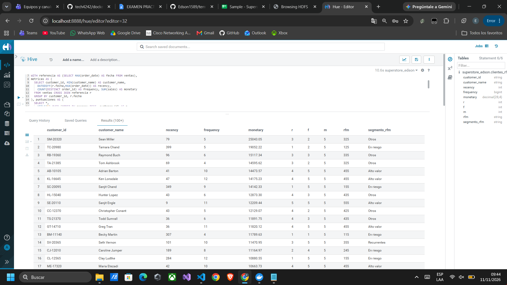

**Resultado obtenido:**

| Segmento | Clientes | Ventas | Días promedio sin comprar |
|---|---:|---:|---:|
| Alto valor | 104 | 553.088,70 | 24,26 |
| Recurrentes | 131 | 369.192,22 | 52,18 |
| En riesgo | 318 | 786.208,41 | 303,46 |
| Otros | 240 | 588.711,53 | 43,98 |

**Interpretación técnica:** encontré 104 clientes que combinan compras recientes, frecuencia e importe elevados. Los 318 clientes en riesgo acumulan ventas importantes, pero llevan más tiempo sin comprar. Un cliente con gasto alto puede estar en riesgo si su última compra es antigua.

**Conclusión:** RFM ayuda a distinguir a los clientes que conviene mantener y a los que se podría volver a contactar para que compren.

## 5. Ranking de productos según rentabilidad

**Enunciado:** obtener cinco productos por categoría con mayor ganancia, cinco con mayor volumen, cinco con menor rentabilidad, margen individual y posición por categoría, usando rankings y acumulados.

**Estrategia:** sumé las ventas, ganancias y unidades de cada producto. Calculé su margen y lo comparé con los demás usando RANK y DENSE_RANK. También calculé la ganancia que se va sumando al recorrer la lista de cada categoría. Usé ROW_NUMBER para elegir exactamente cinco productos, ordenando por ID en caso de empate. Consideré el volumen como unidades vendidas y la menor rentabilidad como el margen porcentual más bajo.

**Consulta HiveQL:** [05_productos.hql](../scripts/05_productos.hql). Genera una selección de 25 filas y muestra el margen y la posición de los 1.862 productos.

**Evidencia:** [registro de ejecución](../evidencias/logs/05_productos.log) y [listas completas](../resultados/05_productos.tsv). Las capturas muestran los márgenes y posiciones de productos de Furniture y parte de la selección de productos con mayores ganancias y menores márgenes.

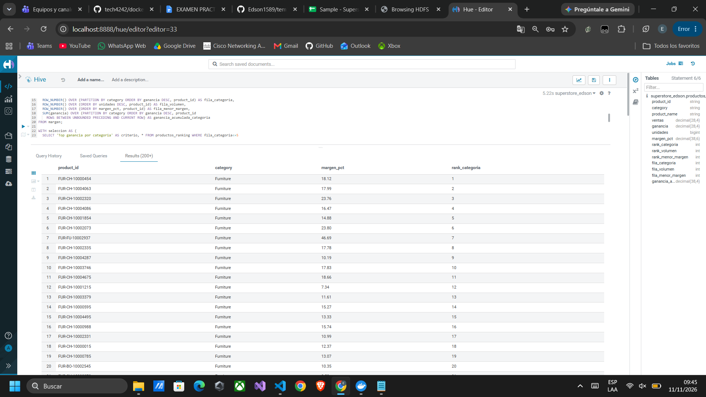

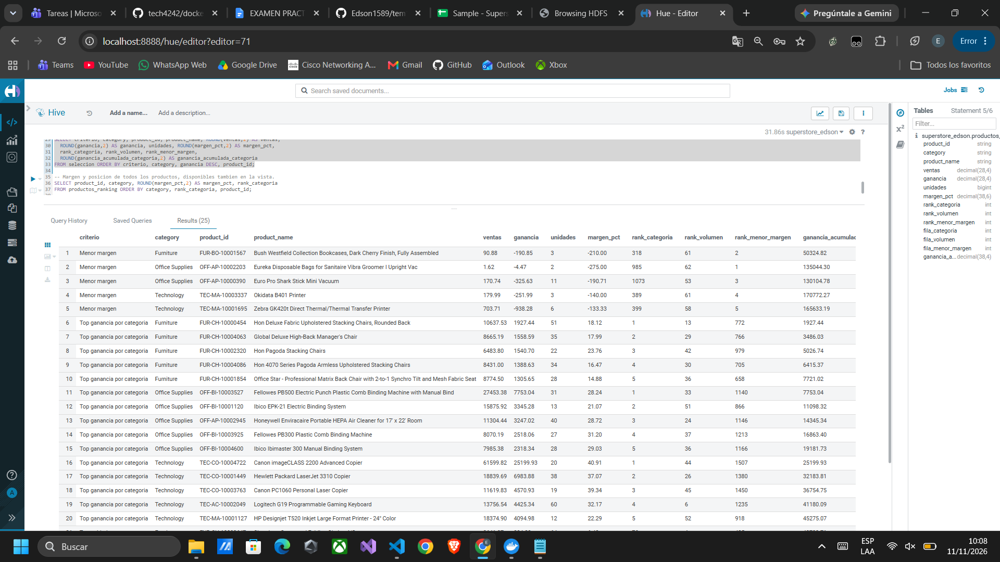

**Resultado obtenido:** los líderes por ganancia son `FUR-CH-10000454` en Furniture (**1.927,44**), `OFF-BI-10003527` en Office Supplies (**7.753,04**) y `TEC-CO-10004722` en Technology (**25.199,93**, margen **40,91%**).

| Productos con más unidades (ID) | Unidades |
|---|---:|
| TEC-AC-10003832 | 75 |
| OFF-PA-10001970 | 70 |
| OFF-BI-10001524 | 67 |
| FUR-CH-10002647 | 64 |
| OFF-BI-10002026 | 64 |

| Cinco menores márgenes: Product ID | Margen |
|---|---:|
| OFF-AP-10002203 | −275,00% |
| FUR-BO-10001567 | −210,00% |
| OFF-AP-10000390 | −190,71% |
| TEC-MA-10003337 | −140,00% |
| TEC-MA-10001695 | −133,33% |

**Interpretación técnica:** comprobé que el producto con más unidades no es el que más ganancia aporta. Un margen inferior a −100% indica que la pérdida supera el importe vendido; no significa un descuento superior a 100%.

**Conclusión:** la evaluación de productos debe combinar unidades, ganancia absoluta y margen para evitar priorizar únicamente el volumen.

## 6. Análisis del impacto de los descuentos

**Enunciado:** clasificar descuentos en cuatro rangos, calcular ventas, ganancias, margen, pérdidas, porcentaje no rentable y descuento promedio, e identificar categorías/subcategorías afectadas.

**Estrategia:** separé las ventas en cuatro grupos: sin descuento, hasta 20%, más de 20% y hasta 50%, y más de 50%. Para cada grupo sumé ventas y ganancias, calculé el margen y conté las filas con pérdidas. Consideré no rentable una fila con ganancia cero o negativa. Después revisé las categorías y subcategorías. El descuento promedio da el mismo peso a cada fila.

**Consulta HiveQL:** [06_descuentos.hql](../scripts/06_descuentos.hql).

**Evidencia:** [registro de ejecución](../evidencias/logs/06_descuentos.log) y [resultados completos](../resultados/06_descuentos.tsv).

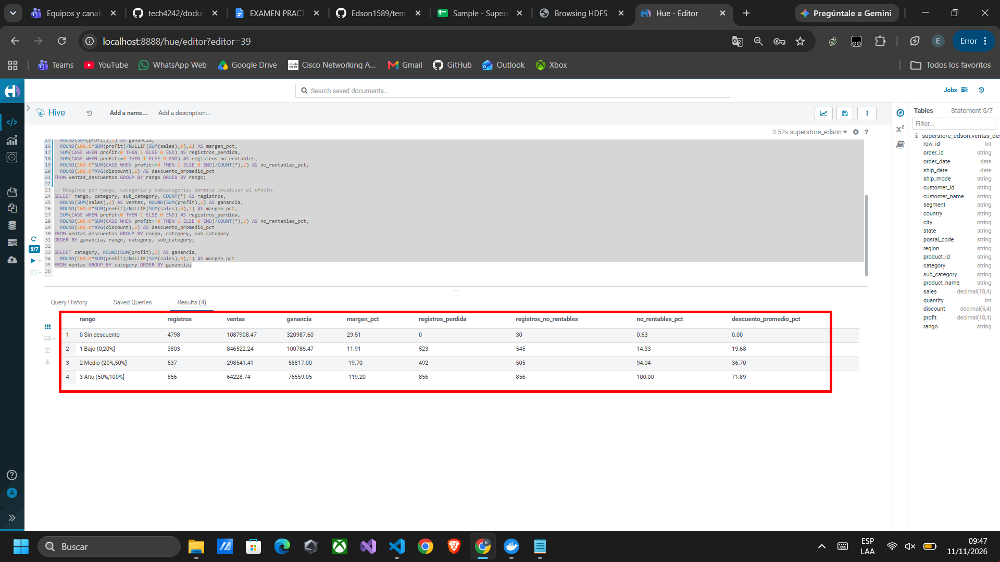

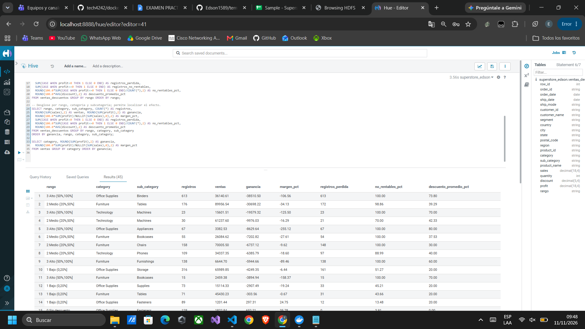

**Resultado obtenido:**

| Rango | Filas | Ventas | Ganancia | Margen | Filas con pérdidas | Porcentaje no rentable | Descuento promedio |
|---|---:|---:|---:|---:|---:|---:|---:|
| Sin descuento | 4.798 | 1.087.908,47 | 320.987,60 | 29,51% | 0 | 0,63% | 0,00% |
| Bajo | 3.803 | 846.522,24 | 100.785,47 | 11,91% | 523 | 14,33% | 19,68% |
| Medio | 537 | 298.541,41 | −58.817,00 | −19,70% | 492 | 94,04% | 36,70% |
| Alto | 856 | 64.228,74 | −76.559,05 | −119,20% | 856 | 100,00% | 71,89% |

Los grupos con mayor pérdida acumulada son **Binders con descuento alto** (−38.510,50), **Tables con descuento medio** (−30.698,22) y **Machines con descuento alto** (−19.579,32). En el total del período, Furniture presenta el margen más bajo: **2,49%**.

**Interpretación técnica:** al aumentar los descuentos también aumenta el porcentaje de ventas sin ganancia. Las 856 filas del grupo de descuento alto tienen pérdidas. Esto no demuestra que el descuento sea la única causa, porque también cambian los productos y las categorías.

**Conclusión:** se deben revisar especialmente descuentos superiores al 20% en los grupos afectados y evaluar la ganancia antes de aplicar promociones.

## 7. Análisis de tendencias temporales

**Enunciado:** calcular ventas y ganancias mensuales, variación respecto al mes anterior y al mismo mes del año anterior, media móvil de tres meses y los tres meses con mayores y menores ventas.

**Estrategia:** sumé las ventas y ganancias de cada mes. Usé LAG para compararlas con el mes anterior y busqué el mismo mes del año anterior para hacer otra comparación. Calculé el promedio de tres meses completos; los dos primeros quedan como NULL porque todavía no hay tres meses. El archivo tiene 48 meses seguidos. Finalmente elegí los tres meses con más ventas y los tres con menos ventas.

**Consulta HiveQL:** [07_tendencias.hql](../scripts/07_tendencias.hql), con indicadores para ventas y ganancias.

**Evidencia:** [registro de ejecución](../evidencias/logs/07_tendencias.log) y [resultados de los 48 meses](../resultados/07_tendencias.tsv).

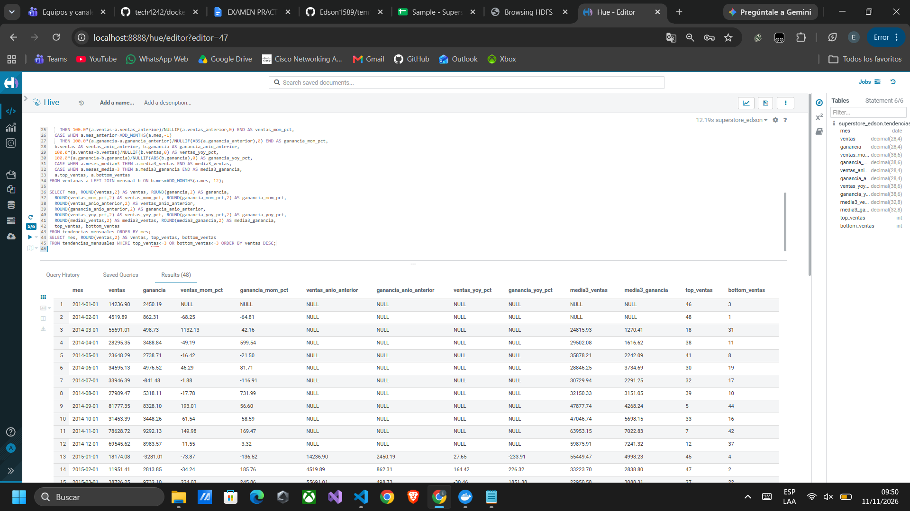

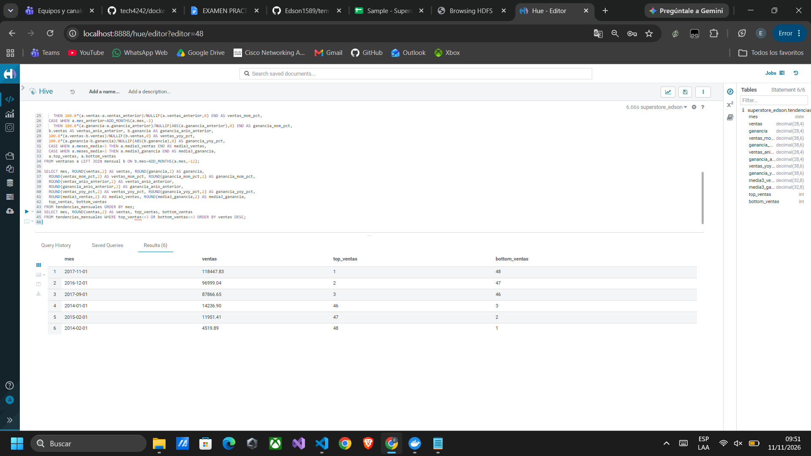

**Resultado obtenido:**

| Selección | Mes | Ventas |
|---|---|---:|
| Mayor 1 | Noviembre 2017 | 118.447,83 |
| Mayor 2 | Diciembre 2016 | 96.999,04 |
| Mayor 3 | Septiembre 2017 | 87.866,65 |
| Menor 1 | Febrero 2014 | 4.519,89 |
| Menor 2 | Febrero 2015 | 11.951,41 |
| Menor 3 | Enero 2014 | 14.236,90 |

Diciembre de 2017 registró ventas de **83.829,32**, una variación mensual de **−29,23%**, interanual de **−13,58%** y media móvil de ventas de **93.351,36**. Su ganancia fue **8.483,35**, con variación interanual de **−52,57%**.

**Interpretación técnica:** observé que los meses con más ventas están cerca del final del año, mientras febrero aparece entre los meses con menos ventas. El promedio de tres meses ayuda a ver la tendencia y comparar con el año anterior ayuda a entender si el cambio se relaciona con la época del año. Los cuatro años revisados muestran este comportamiento, aunque no aseguran que se repita.

**Conclusión:** conviene comparar tanto con el mes anterior como con el año anterior para planificar las existencias y revisar las caídas en las ganancias.

## 8. Análisis Pareto de ventas y rentabilidad

**Enunciado:** determinar, de forma independiente, cuántos productos representan el 80% de ventas y ganancias, calculando participación individual y acumulada y comparando la concentración.

**Estrategia:** ordené los productos de mayor a menor aporte y fui sumando con SUM OVER hasta alcanzar al menos el 80% del total. Incluí el producto con el que se llega a ese porcentaje. Hice el cálculo por separado para ventas y **ganancia neta**, manteniendo las pérdidas en el total.

**Consulta HiveQL:** [08_pareto.hql](../scripts/08_pareto.hql), con resumen y detalle ordenado de todos los productos para ambas métricas.

**Evidencia:** [registro de ejecución](../evidencias/logs/08_pareto.log) y [resumen y aportes de todos los productos](../resultados/08_pareto.tsv).

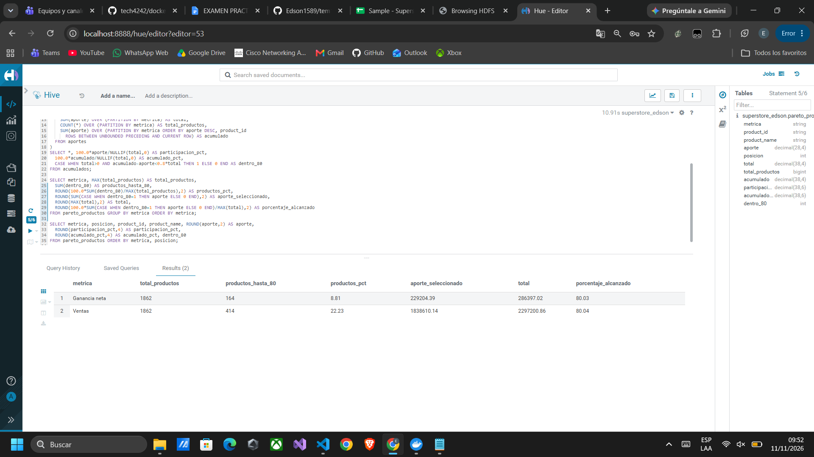

**Resultado obtenido:**

| Métrica | Productos hasta 80% | % de los 1.862 productos | Aporte seleccionado | Porcentaje alcanzado |
|---|---:|---:|---:|---:|
| Ventas | 414 | 22,23% | 1.838.610,14 | 80,04% |
| Ganancia neta | 164 | 8,81% | 229.204,39 | 80,03% |

`TEC-CO-10004722`, Canon imageCLASS 2200 Advanced Copier, lidera ambas métricas: ventas de **61.599,82** y ganancias de **25.199,93**. Aporta por sí solo **8,80%** de la ganancia neta. En ganancias le siguen `OFF-BI-10003527` y `TEC-CO-10001449`.

**Interpretación técnica:** un grupo pequeño de productos reúne la mayor parte de las ventas y un grupo todavía menor reúne la mayor parte de la ganancia. Como las pérdidas reducen la ganancia total, el resultado sería distinto si solo sumara productos con ganancias positivas. Por la misma razón, la suma acumulada puede pasar del 100% antes de restar las pérdidas de los últimos productos.

**Conclusión:** se necesitan menos productos para concentrar la ganancia que las ventas. Conviene proteger los productos rentables y revisar los que venden sin aportar ganancia; la regla 80/20 es una referencia, no una proporción que deba cumplirse exactamente.
